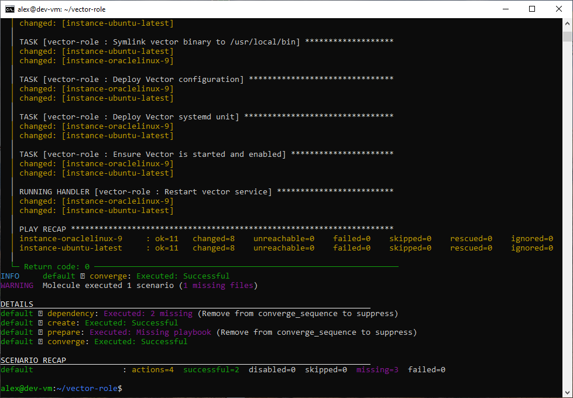
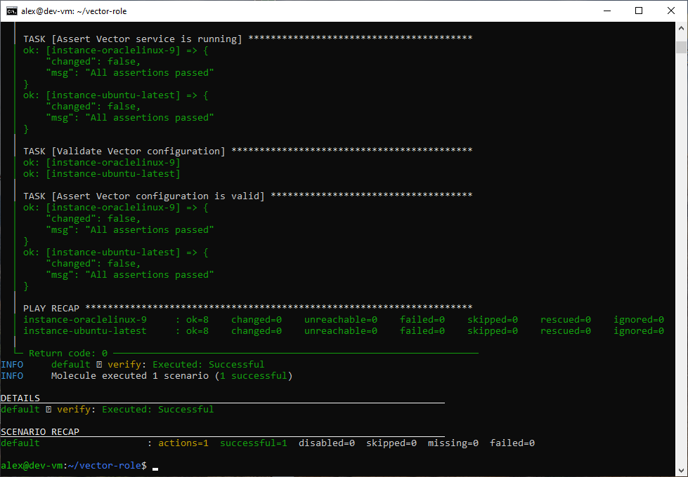

# Домашнее задание к занятию 5 «Тестирование roles»

**Репозиторий отчёта:** https://github.com/akamsoft/ansible-homework-05

**Репозиторий с ролью Vector:** https://github.com/akamsoft/vector-role

**Репозиторий с ролью LightHouse:** https://github.com/akamsoft/lighthouse-role

---

## 📖 О чём это задание

В рамках домашнего задания настроено тестирование Ansible-ролей с помощью **Molecule** на драйверах **Docker** и **Podman**, автоматизирован запуск через **tox**, а также созданы два дополнительных сценария: изолированный для роли LightHouse и интеграционный для всего стека **ClickHouse + Vector + LightHouse**.

Все сценарии успешно проходят тестирование, роль идемпотентна, интеграция между сервисами подтверждена.

---

## 🖥️ Окружение и подготовка

Тестирование выполнялось на `dev-vm` (Debian 13, Python 3.13). Molecule и tox установлены через `pipx` в изолированные виртуальные окружения — это позволило не затрагивать системный Python и избежать конфликтов с системными пакетами.

Дополнительно установлены коллекции Ansible `community.docker`, `containers.podman` и `ansible.posix` — они нужны для работы драйверов Molecule и для задач SELinux.

Для контейнерных тестов выбран образ `geerlingguy/docker-ubuntu2204-ansible` — он уже содержит Python и настроенный systemd, что критически важно для ролей, управляющих сервисами.

---

## ✅ Основная часть: сценарий `molecule/default` в `vector-role`

### Что сделано

1. Создан сценарий `molecule/default` с **двумя платформами** — Oracle Linux 9 и Ubuntu latest.
2. Настроен delegated-драйвер (`driver: default`) с явным `create.yml`, который создаёт контейнеры и формирует inventory с connection-плагином `community.docker.docker`. Это решение выбрано после того, как встроенный Docker-драйвер в Molecule 26 отказывался корректно создавать контейнеры.
3. В `molecule.yml` заданы параметры для работы systemd внутри контейнера: `privileged: true`, монтирование `cgroups`, правильные команды запуска (`/usr/sbin/init` для Oracle, `/sbin/init` для Ubuntu).
4. Настроен `remote_tmp: /tmp` и `roles_path` — чтобы Ansible находил роль и не упирался в права на домашний каталог.
5. Написан `verify.yml` с **8 assert-проверками**: наличие бинарника Vector, его исполнимость, наличие конфига `/etc/vector/vector.yaml`, статус сервиса `active`, валидность конфига через `vector validate`.

### Результат

Сценарий `molecule test` проходит полностью: создание двух контейнеров, применение роли (8 изменений на каждом), проверка идемпотентности (`changed=0`), 8 из 8 assert-проверок на обоих дистрибутивах, удаление контейнеров. Итог — `failed=0`.

**Скриншоты:** 

---

## 🐳 Дополнительно: облегчённый сценарий `molecule/podman` и `tox`

### Что сделано

1. Создан облегчённый сценарий `molecule/podman` с одной платформой (Ubuntu latest) и драйвером Podman.
2. Для работы Podman внутри Docker-контейнера пришлось решить несколько проблем:
   - настроен `network: host` — обходной путь из-за отсутствия `/dev/net/tun` для сетевых бэкендов `pasta`/`slirp4netns`;
   - написан явный `create.yml` с `containers.podman.podman_container` и формированием inventory с `ansible_connection: containers.podman.podman`;
   - параметр `force_kill` заменён на `force_delete` (актуальный в модуле podman_container);
   - `roles_path` дополнен путём `~/.ansible/roles`, где лежит внешняя роль ClickHouse;
   - `systemd: always` и удаление `tmpfs` — чтобы соответствовать новой схеме molecule-plugins.
3. Создан `tox.ini`, который запускает `molecule test -s podman` в изолированном виртуальном окружении.

### Результат

`molecule test -s podman` проходит успешно (12 действий, 7 успешных, 5 отсутствующих playbook'ов — это норма). `tox` также завершается успешно за 84 секунды с сообщением `molecule: OK` и `congratulations :)`.

**Скриншот:** `images/04-tox.png`.

---

## 🏠 Необязательная часть 1: сценарий `molecule/lighthouse` в `lighthouse-role`

### Что сделано

1. Роль `lighthouse-role` сделана **кроссплатформенной**:
   - пользователь и группа Nginx определяются через переменную в зависимости от семейства ОС (`www-data` на Ubuntu, `nginx` на RedHat);
   - задача `lineinfile` по переносу дефолтного server на порт 8080 выполняется только на RedHat (на Ubuntu файл `nginx.conf` не содержит `listen 80`);
   - задача SELinux `seboolean` выполняется только на RedHat;
   - добавлена задача удаления дефолтного сайта `/etc/nginx/sites-enabled/default` для Ubuntu.
2. Создан сценарий `molecule/lighthouse` на драйвере Docker с одной платформой (Ubuntu).
3. Написан `prepare.yml` — обновляет `apt cache` и устанавливает `gnupg` и `dirmngr`, без которых не работал импорт GPG-ключей ClickHouse.
4. Написан `verify.yml` — проверяет, что Nginx запущен и что главная страница содержит `LightHouse`.

### Результат

`molecule test -s lighthouse` проходит полностью: 12 действий, 8 успешных, `failed=0`. Идемпотентность подтверждена, verify зелёный.

**Скриншот:** `images/05-lighthouse-role-test.png`.

**Тег:** `v1.2.0` в `lighthouse-role`.

---

## 🔗 Необязательная часть 2: интеграционный сценарий `molecule/stack`

### Что сделано

1. В `vector-role` создан интеграционный сценарий `molecule/stack`, который поднимает **три контейнера** — ClickHouse, Vector, LightHouse — и применяет к ним соответствующие роли.
2. Настроен `create.yml` с явным распределением контейнеров по группам `clickhouse`, `vector`, `lighthouse` — чтобы `converge.yml` мог обращаться к каждой группе отдельно.
3. Написан `prepare.yml` — обновление `apt cache` и установка `gnupg`/`dirmngr` для всех трёх хостов.
4. В `converge.yml` для ClickHouse добавлены обходные решения для работы в контейнере:
   - принудительное использование IPv4 для `apt` — из-за недоступности IPv6-адресов репозитория ClickHouse;
   - удаление кастомного unit-файла перед запуском;
   - systemd drop-in с `Type=simple`, `KillMode=process`, отключённым watchdog и `TimeoutStartSec=infinity` — обход конфликта `sd_notify`;
   - `config.d/thread_pool.xml` с уменьшенным `background_schedule_pool_size` — обход ошибки `Not enough threads`.
5. Написан интеграционный `verify.yml` из трёх частей:
   - проверка ClickHouse: HTTP-запрос `SELECT version()` возвращает `24.x`;
   - проверка Vector: бинарник исполняем, конфиг валиден;
   - **проверка интеграции**: LightHouse на порту 8080 отдаёт страницу, а запрос `/clickhouse/?query=SELECT version()` через прокси возвращает версию ClickHouse.

### Результат

`molecule test -s stack` проходит полностью: 12 действий, 8 успешных, `failed=0`. Все три хоста в `PLAY RECAP` с `failed=0`. Ключевая проверка `Assert integration works (ClickHouse version via LightHouse proxy)` вернула `All assertions passed` — это доказывает, что весь стек работает совместно.

**Скриншоты:** `images/06-stack-test.png`, `images/07-stack-verify.png`.

**Тег:** `v1.3.0` в `vector-role`.

---

## 📌 Основные технические решения и особенности

**Molecule 26 и delegated driver.** Встроенный Docker-драйвер в Molecule 26 иногда не создаёт контейнеры, если в `molecule.yml` только платформы без явного `create.yml`. Решение — использовать delegated-драйвер (`driver: default`) с явным созданием контейнеров и генерацией inventory.

**Podman в контейнере.** Вложенная контейнеризация Podman в Docker требует `privileged: true`, `network: host` и явного указания `ansible_connection: containers.podman.podman` в inventory.

**ClickHouse в контейнере.** Пришлось решать четыре независимые проблемы: конфликт `sd_notify` (drop-in с `Type=simple` и `KillMode=process`), нехватку потоков (`background_schedule_pool_size=128`), недоступность IPv6 (`ForceIPv4` для apt) и отсутствие `dirmngr` для GPG-ключей (задача в `prepare.yml`).

**Кроссплатформенность ролей.** В `lighthouse-role` все RedHat-специфичные операции (SELinux, `lineinfile` для дефолтного server) обёрнуты в `when: ansible_os_family == 'RedHat'`. На Ubuntu выполняются другие задачи — удаление `sites-enabled/default`. Это стандартный паттерн для ролей, работающих на нескольких дистрибутивах.

**Полный путь к бинарнику в verify.** В контейнерах `PATH` для root может не содержать `/usr/local/bin`. Поэтому в `verify.yml` используются `{{ vector_bin }} --version` и `{{ vector_bin }} validate …` с полным путём, а не просто `vector`.

---

## 🖼️ Скриншоты

| Файл | Что показано |
|---|---|
| `images/01-molecule-converge.png` | `molecule converge` (default) — 8 изменений на обоих хостах |
| `images/02-molecule-verify.png` | `molecule verify` (default) — 8 из 8 assert-проверок |
| `images/03-molecule-test.png` | `molecule test` (default) — `SCENARIO RECAP … failed=0` |
| `images/04-tox.png` | `tox` — `molecule: OK` за 84 секунды |
| `images/05-lighthouse-role-test.png` | `molecule test -s lighthouse` — `failed=0` |
| `images/06-stack-test.png` | `molecule test -s stack` — `failed=0` |
| `images/07-stack-verify.png` | `PLAY RECAP` с тремя хостами, все `failed=0` |

---

## 🏷️ Теги

| Репозиторий | Тег | Что фиксирует |
|---|---|---|
| `vector-role` | `v1.0.0` | Сценарий `molecule/default` (Docker, 2 платформы) + `verify.yml` |
| `vector-role` | `v1.1.0` | Сценарий `molecule/podman` + `tox.ini` |
| `vector-role` | `v1.3.0` | Интеграционный сценарий `molecule/stack` |
| `lighthouse-role` | `v1.2.0` | Сценарий `molecule/lighthouse` + кроссплатформенность |

Ссылки на релизы:

- `https://github.com/akamsoft/vector-role/releases/tag/v1.0.0`
- `https://github.com/akamsoft/vector-role/releases/tag/v1.1.0`
- `https://github.com/akamsoft/vector-role/releases/tag/v1.3.0`
- `https://github.com/akamsoft/lighthouse-role/releases/tag/v1.2.0`

---

## 📤 Ссылки

- **Отчёт:** https://github.com/akamsoft/ansible-homework-05/blob/main/README.md
- **Роль Vector:** https://github.com/akamsoft/vector-role
  - `v1.0.0` (Molecule default): https://github.com/akamsoft/vector-role/releases/tag/v1.0.0
  - `v1.1.0` (Podman + Tox): https://github.com/akamsoft/vector-role/releases/tag/v1.1.0
  - `v1.3.0` (Stack integration): https://github.com/akamsoft/vector-role/releases/tag/v1.3.0
- **Роль LightHouse:** https://github.com/akamsoft/lighthouse-role
  - `v1.2.0`: https://github.com/akamsoft/lighthouse-role/releases/tag/v1.2.0
- **Сценарии Molecule:** https://github.com/akamsoft/vector-role/tree/main/molecule
- **`tox.ini`:** https://github.com/akamsoft/vector-role/blob/main/tox.ini
